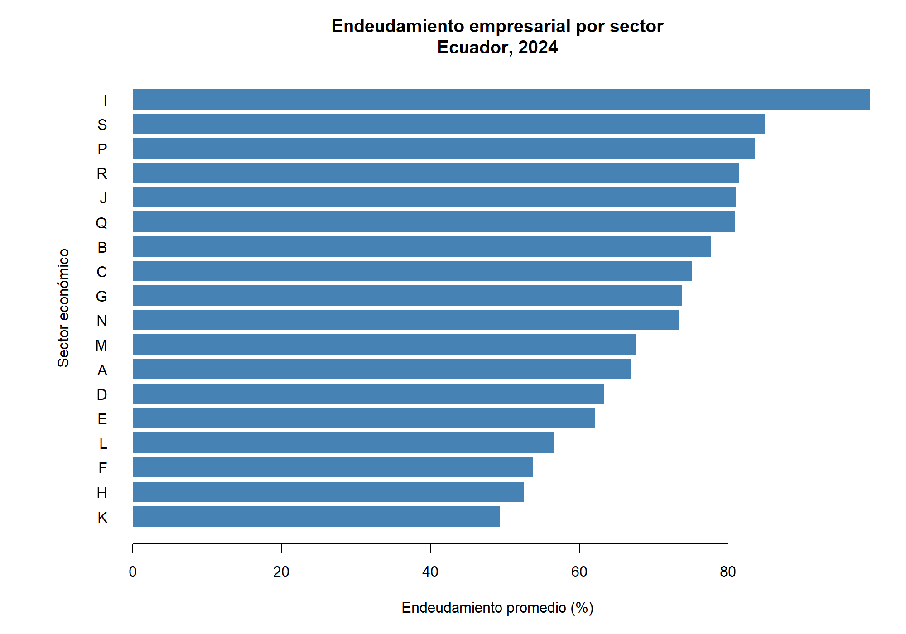
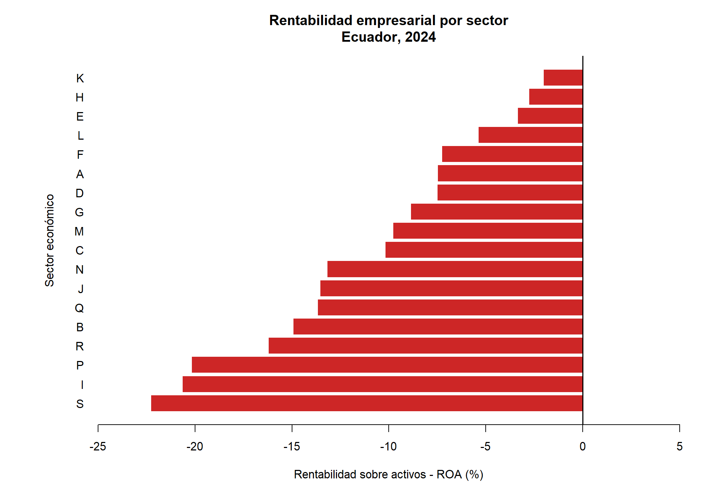

# Resumen {.unnumbered}

¿Hasta qué punto el endeudamiento representa una oportunidad de crecimiento o un riesgo para la rentabilidad empresarial? Esta investigación examina la relación entre el endeudamiento y la rentabilidad de las empresas ecuatorianas durante 2024, utilizando información financiera de 145.034 empresas registrada por la Superintendencia de Compañías, Valores y Seguros del Ecuador. Mediante un enfoque cuantitativo, se desarrolla un análisis financiero, sectorial y empresarial, complementado con modelos econométricos de mínimos cuadrados ordinarios (MCO) y errores estándar robustos. Los resultados evidencian una relación negativa y estadísticamente significativa entre el endeudamiento y la rentabilidad sobre activos (ROA). En el modelo principal, que incorpora controles por tamaño empresarial y actividad económica, el coeficiente estimado es de -0,2891. Asimismo, las empresas con endeudamiento superior al 100 % presentan una rentabilidad mediana de -12,74 %, mientras que aquellas con endeudamiento positivo de hasta el 50 % alcanzan el 3,43 %. Las pruebas de robustez mantienen la relación negativa, aunque muestran variaciones importantes en su magnitud. Los hallazgos sugieren que el endeudamiento elevado se asocia con resultados financieros más desfavorables, sin establecer una relación causal.

**Palabras clave:** endeudamiento empresarial, rentabilidad financiera, estructura de capital, rentabilidad sobre activos (ROA), análisis econométrico.

# Introducción

El endeudamiento representa una decisión importante para las empresas, ya que permite financiar sus actividades, realizar inversiones y aprovechar oportunidades de crecimiento. Sin embargo, asumir obligaciones financieras también implica compromisos que pueden afectar los resultados económicos cuando los recursos disponibles no son suficientes para responder a ellos. Por esta razón, resulta necesario analizar hasta qué punto el financiamiento mediante deuda se relaciona con la rentabilidad empresarial.

La relación entre endeudamiento y rentabilidad ha sido estudiada desde diferentes perspectivas. @abor_effect_2005, al analizar empresas de Ghana, encontró que los resultados varían según la composición de la deuda, identificando relaciones positivas y negativas dependiendo de su plazo. Esta evidencia muestra que el endeudamiento no necesariamente se relaciona de la misma manera con la rentabilidad en todas las empresas.

En Ecuador, las empresas pertenecen a distintos sectores económicos y presentan diferencias en sus activos, obligaciones y resultados financieros. Estas características hacen relevante estudiar si las empresas con mayores niveles de endeudamiento también presentan diferencias en su capacidad para generar rentabilidad. El análisis de los estados financieros permite examinar esta relación mediante indicadores que reflejan la estructura de financiamiento y el rendimiento obtenido sobre los activos.

En este contexto, la presente investigación plantea la siguiente pregunta: ¿qué relación existe entre el endeudamiento y la rentabilidad de las empresas ecuatorianas durante 2024? Para responderla, se utilizan los estados financieros de 145.034 empresas registrados por la Superintendencia de Compañías, Valores y Seguros del Ecuador. Se desarrolla un análisis descriptivo, sectorial y empresarial, complementado con estimaciones econométricas de mínimos cuadrados ordinarios.

El estudio busca aportar evidencia sobre la asociación entre el endeudamiento y la rentabilidad empresarial, considerando las diferencias de tamaño y actividad económica. Asimismo, permite identificar comportamientos financieros que pueden resultar relevantes para comprender la situación de las empresas ecuatorianas durante 2024, sin atribuir una relación causal a los resultados obtenidos.

# Revisión de literatura

## Antecedentes teóricos

La relación entre el endeudamiento y el desempeño empresarial puede analizarse a partir de la teoría de la estructura de capital. Modigliani y Miller [-@modigliani_cost_1958] plantearon que, bajo condiciones ideales de mercado, el valor de una empresa no depende de la combinación de deuda y capital propio utilizada para financiar sus actividades. Este planteamiento constituye un punto de partida para comprender por qué las decisiones de financiamiento adquieren importancia cuando existen impuestos, costos financieros y otras imperfecciones del mercado.

La teoría del equilibrio o Trade-off constituye otro enfoque para comprender las decisiones de financiamiento empresarial. Myers [-@myers_capital_1984] explica que las empresas pueden buscar un nivel de endeudamiento que permita aprovechar los beneficios tributarios de la deuda, considerando al mismo tiempo los costos asociados a posibles dificultades financieras. Desde esta perspectiva, el endeudamiento puede representar una alternativa para financiar las actividades empresariales, pero su utilización excesiva también puede incrementar los riesgos y afectar el desempeño económico. Este planteamiento resulta relevante para analizar la relación entre endeudamiento y rentabilidad en las empresas ecuatorianas durante 2024.

La teoría de la jerarquía financiera, conocida como Pecking Order, ofrece otra explicación sobre las decisiones de financiamiento. Myers y Majluf [-@myers_corporate_1984] analizan cómo las diferencias de información entre los administradores y los inversionistas pueden influir en la elección de las fuentes de financiamiento. Desde este enfoque, las empresas tienden a preferir los recursos generados internamente, seguidos del endeudamiento y, finalmente, de la emisión de acciones. Esta teoría permite comprender que las decisiones de recurrir a deuda no dependen únicamente de sus costos, sino también de la disponibilidad de recursos propios y de las condiciones de financiamiento. Por ello, constituye una base teórica para estudiar las diferencias de endeudamiento entre las empresas ecuatorianas durante 2024.

## Evidencia empírica

La evidencia empírica sobre endeudamiento y rentabilidad muestra que esta relación puede variar según la composición de la deuda y las características de las empresas. Abor [-@abor_effect_2005] analizó empresas cotizadas en Ghana y encontró una relación positiva entre la deuda de corto plazo y la rentabilidad, mientras que la deuda de largo plazo presentó una relación negativa. Estos resultados sugieren que no basta con considerar el nivel total de endeudamiento, sino que también resulta importante examinar cómo se estructura el financiamiento. Para el caso ecuatoriano, este antecedente permite contextualizar el análisis de la relación entre el endeudamiento total y la rentabilidad empresarial en 2024, aunque nuestro estudio no distingue entre deuda de corto y largo plazo.


La evidencia internacional también destaca la importancia de las características empresariales en las decisiones de financiamiento. Rajan y Zingales [-@rajan_what_1995] examinaron la estructura de capital de empresas pertenecientes a siete países industrializados y encontraron que factores como el tamaño empresarial, la rentabilidad y la composición de los activos se relacionan con las diferencias en los niveles de endeudamiento. Este estudio permite comprender que las decisiones financieras no dependen únicamente de la disponibilidad de crédito, sino también de las características de cada empresa. Para nuestra investigación sobre Ecuador en 2024, constituye un antecedente relevante para considerar el tamaño empresarial y las diferencias sectoriales al analizar la relación entre endeudamiento y rentabilidad.


Le y Phan [-@le_capital_2017] analizaron empresas no financieras de Vietnam y encontraron una relación negativa entre el endeudamiento y el desempeño empresarial. Este resultado muestra que un mayor nivel de deuda no necesariamente se relaciona con una mejor rentabilidad.

Margaritis y Psillaki [-@margaritis_efficiency_2007] estudiaron empresas de Nueva Zelanda y analizaron la relación entre endeudamiento y eficiencia empresarial. Posteriormente, estos autores [-@margaritis_ownership_2010] examinaron empresas manufactureras francesas y destacaron la importancia de la estructura de capital y la propiedad empresarial para comprender las diferencias en el desempeño.

Berger y Bonaccorsi di Patti [-@berger_capital_2006] analizaron el sector bancario y encontraron evidencia de que un mayor apalancamiento puede relacionarse con una mayor eficiencia de beneficios. Este resultado muestra que la relación entre deuda y desempeño puede variar según las características del sector.

Mallick y Yang [-@mallick_financing_2011] estudiaron empresas de distintos países y analizaron cómo las fuentes de financiamiento se relacionan con la rentabilidad y la productividad. Su investigación permite considerar que el origen de los recursos financieros también puede influir en las diferencias observadas entre empresas.

González [-@gonzalez_leverage_2013] analizó empresas de distintos países y encontró que un mayor endeudamiento puede relacionarse con un menor desempeño durante las caídas de los sectores económicos. Esto permite comprender que las condiciones económicas también son importantes para interpretar los resultados financieros.

Davydov [-@davydov_debt_2016] examinó empresas de mercados emergentes y estudió las diferencias entre el financiamiento bancario y otras formas de deuda. Sus resultados muestran la importancia de considerar la composición del endeudamiento al analizar el desempeño empresarial.

Chadha y Sharma [-@chadha_capital_2016] analizaron empresas manufactureras de India mediante indicadores como ROA, ROE y Q de Tobin. Este antecedente es importante porque utiliza medidas de rentabilidad similares a las consideradas en nuestra investigación.

Nguyen y colaboradores [-@nguyen_relationship_2023] estudiaron empresas cotizadas de Vietnam y analizaron la relación entre la estructura de capital y la rentabilidad. Su investigación aporta evidencia adicional sobre cómo las decisiones de financiamiento pueden relacionarse con los resultados empresariales.

En conjunto, estas investigaciones muestran que la relación entre endeudamiento y rentabilidad no es igual en todos los países ni sectores. Para nuestro estudio de Ecuador en 2024, estos antecedentes ayudan a interpretar la asociación negativa encontrada entre endeudamiento y ROA, sin afirmar que exista necesariamente una relación causal.

# Objetivos

## Objetivo general

Analizar la relación entre el endeudamiento y la rentabilidad de las empresas ecuatorianas durante 2024, mediante indicadores financieros y modelos econométricos, considerando las diferencias de tamaño empresarial y actividad económica.

## Objetivos específicos

1. Describir los niveles de endeudamiento y rentabilidad de las empresas ecuatorianas durante 2024, identificando diferencias según el sector económico y el tamaño empresarial.
2. Estimar la relación entre el endeudamiento y la rentabilidad sobre activos (ROA) mediante modelos de mínimos cuadrados ordinarios, incorporando controles empresariales y pruebas de robustez.

# Datos y metodología

## Fuente de información

La investigación utiliza información financiera correspondiente al año 2024, obtenida de los estados financieros registrados en la Superintendencia de Compañías, Valores y Seguros del Ecuador. La base de datos comprende 145.034 empresas ecuatorianas pertenecientes a diferentes actividades económicas y tamaños empresariales. Esta información permite examinar las diferencias en los niveles de endeudamiento y rentabilidad, a partir de los resultados financieros reportados por las empresas durante el período de estudio.

## Variables e indicadores financieros

La investigación considera como variable dependiente la rentabilidad sobre activos (ROA), que permite conocer el resultado financiero obtenido por las empresas en relación con sus activos totales. Este indicador se calcula dividiendo el resultado del ejercicio (cuenta 707) para el activo total (cuenta 1) y multiplicando el resultado por 100.

$$
ROA = \frac{\text{Resultado del ejercicio}}{\text{Activo total}} \times 100
$$

Como variable independiente se utiliza el endeudamiento empresarial, que representa la proporción de los activos financiada mediante obligaciones con terceros. Se calcula dividiendo el pasivo total (cuenta 2) para el activo total (cuenta 1) y multiplicando por 100.

$$
Endeudamiento = \frac{\text{Pasivo total}}{\text{Activo total}} \times 100
$$

Adicionalmente, se consideran las diferencias de tamaño empresarial y actividad económica para analizar la relación entre endeudamiento y rentabilidad. La actividad económica se identifica mediante la clasificación sectorial disponible en la base financiera.

## Modelo econométrico

Para examinar la relación entre el endeudamiento y la rentabilidad empresarial se estimaron modelos de mínimos cuadrados ordinarios (MCO). El primer modelo considera únicamente el endeudamiento como variable explicativa, mientras que el segundo incorpora el tamaño empresarial y controles por actividad económica. Este último constituye la especificación principal de la investigación.

$$
ROA_i = \beta_0 + \beta_1 END_i + \beta_2 TAM_i + \sum_{s=1}^{S-1} \gamma_s SECTOR_{is} + \varepsilon_i
$$

En esta ecuación, ROA representa la rentabilidad sobre activos; END corresponde al porcentaje de endeudamiento; TAM representa el tamaño empresarial, medido mediante el logaritmo natural de los activos totales; y SECTOR recoge las diferencias entre actividades económicas mediante variables indicadoras.

Para reducir la influencia de valores extremos se utilizaron versiones winsorizadas del ROA y del endeudamiento, con límites próximos a los percentiles 1 y 99. Además, se calcularon errores estándar robustos para evaluar la significancia estadística de los coeficientes. Los resultados se interpretan como asociaciones estadísticas y no como efectos causales.

# Resultados y análisis

## Diagnóstico financiero

El análisis descriptivo comprende 145.034 empresas ecuatorianas durante 2024. Los resultados muestran un endeudamiento promedio de 68,85 %, mientras que la mediana fue de 31,89 %. Esta diferencia indica que existen empresas con niveles de endeudamiento considerablemente elevados que influyen en el promedio general.

En cuanto a la rentabilidad, el ROA promedio fue de -9,35 %, mientras que la mediana se ubicó en 0 %. Esto refleja que, aunque algunas empresas registraron resultados positivos, también existen empresas con pérdidas importantes que afectan la rentabilidad promedio. En conjunto, los resultados evidencian diferencias importantes en la situación financiera de las empresas analizadas.

La Tabla 1 presenta las principales estadísticas descriptivas de los indicadores financieros.

| Indicador | Endeudamiento (%) | ROA (%) |
|:---|---:|---:|
| Observaciones | 145.034 | 145.034 |
| Media | 68,85 | -9,35 |
| Mediana | 31,89 | 0,00 |
| Desviación estándar | 169,65 | 84,22 |
| Mínimo | 0,00 | -673,46 |
| Máximo | 1.399,78 | 88,19 |

*Nota.* Estadísticas descriptivas calculadas con la base financiera de empresas ecuatorianas, 2024. Los indicadores corresponden a las variables utilizadas en el análisis econométrico.

## Diagnóstico sectorial

El análisis sectorial evidencia diferencias en los niveles de endeudamiento y rentabilidad de las empresas ecuatorianas durante 2024. Entre los sectores con mayor número de observaciones, las actividades de alojamiento y servicios de comidas presentan un endeudamiento promedio de 99,07 % y una rentabilidad sobre activos (ROA) promedio de -20,63 %. Por su parte, las actividades financieras y de seguros registran un endeudamiento promedio de 49,36 % y un ROA de -2,02 %.

En relación con la distribución empresarial, el comercio al por mayor y menor concentra 34.512 empresas, seguido de las actividades profesionales, científicas y técnicas, con 20.161 empresas, y el transporte y almacenamiento, con 14.644 empresas. Esta distribución muestra que la participación empresarial no es uniforme entre las distintas actividades económicas.

En conjunto, los resultados reflejan diferencias importantes en la situación financiera de los sectores analizados. Aunque algunas actividades presentan simultáneamente niveles elevados de endeudamiento y rentabilidades negativas, estas diferencias no permiten establecer una relación causal, debido a que cada sector presenta condiciones económicas y empresariales particulares.

La Figura 2 presenta las diferencias en los niveles de endeudamiento por actividad económica.

{#fig-endeudamiento-sectorial width=90%}

La Figura 3 muestra la rentabilidad sobre activos por actividad económica.

{#fig-roa-sectorial width=90%}

## Diagnóstico empresarial

El análisis de las 145.034 empresas ecuatorianas durante 2024 muestra diferencias importantes en la rentabilidad según sus niveles de endeudamiento. Las empresas con endeudamiento de hasta el 50 % registraron el mayor ROA promedio, con 10,25 %, mientras que aquellas con niveles de deuda entre el 50 % y el 100 % presentaron una rentabilidad promedio de 1,53 %.

Por otra parte, las empresas sin deuda registraron un ROA promedio de -4,31 %. La situación más desfavorable se observa en las empresas cuyo endeudamiento supera el 100 %, con una rentabilidad promedio de -105,70 % y una mediana de -12,74 %. Esto evidencia que los resultados negativos son especialmente pronunciados en el grupo de mayor endeudamiento.

En conjunto, los resultados muestran que las empresas con niveles moderados de endeudamiento presentan una mayor rentabilidad promedio que aquellas con niveles elevados de deuda. No obstante, estas diferencias representan asociaciones descriptivas y no permiten establecer que el endeudamiento sea la causa directa de las pérdidas empresariales.

La Tabla 2 presenta los principales resultados según el nivel de endeudamiento.

| Nivel de endeudamiento | Empresas | ROA promedio (%) | ROA mediano (%) |
|:---|---:|---:|---:|
| Sin deuda | 45.711 | -4,31 | 0,00 |
| Hasta 50 % | 37.436 | 10,25 | 3,43 |
| Entre 50 % y 100 % | 46.611 | 1,53 | 1,05 |
| Más de 100 % | 15.276 | -105,70 | -12,74 |

*Nota.* Elaboración propia con datos financieros de empresas ecuatorianas, 2024.

## Resultados econométricos

Los resultados de los modelos de mínimos cuadrados ordinarios (MCO) muestran una relación negativa y estadísticamente significativa entre el endeudamiento y la rentabilidad de las empresas ecuatorianas durante 2024. En el Modelo 1, el coeficiente del endeudamiento fue de -0,2919, lo que indica que un aumento de un punto porcentual en el endeudamiento se asocia con una disminución aproximada de 0,29 puntos porcentuales en el ROA.

En el Modelo 2, al incorporar el tamaño empresarial y los controles sectoriales, el coeficiente del endeudamiento se mantiene negativo (-0,2891) y estadísticamente significativo al 1 %. Esto evidencia que la relación negativa persiste después de considerar las diferencias de tamaño y actividad económica entre las empresas.

Por otra parte, el tamaño empresarial presenta un coeficiente positivo de 4,1692, estadísticamente significativo al 1 %. Esto indica que las empresas con mayores activos tienden a registrar una mayor rentabilidad, manteniendo constantes las demás variables del modelo.

El coeficiente de determinación (R²) aumenta de 0,3458 en el Modelo 1 a 0,3693 en el Modelo 2. Esto significa que la incorporación del tamaño empresarial y los controles sectoriales mejora la capacidad explicativa del modelo. Sin embargo, los resultados representan asociaciones estadísticas y no permiten establecer efectos causales.

**Tabla 3. Resultados de los modelos econométricos**

| Variable | Modelo 1 | Modelo 2 |
|:---|---:|---:|
| Endeudamiento (%) | -0,2919*** | -0,2891*** |
| Error estándar robusto | (0,0046) | (0,0046) |
| Tamaño empresarial | — | 4,1692*** |
| Error estándar robusto | — | (0,0707) |
| Controles sectoriales | No | Sí |
| R² | 0,3458 | 0,3693 |
| Observaciones | 145.034 | 145.033 |

*Nota.* Errores estándar robustos HC1 entre paréntesis. *** indica significancia estadística al 1 %. Elaboración propia con datos financieros de empresas ecuatorianas, 2024.

## Pruebas de robustez

Para comprobar la estabilidad de los resultados econométricos, se realizaron tres estimaciones. La primera utiliza variables winsorizadas entre los percentiles 1 y 99, la segunda considera los datos sin winsorizar y la tercera incluye únicamente empresas con activos iguales o superiores a 1.000 dólares.

Los resultados muestran que el endeudamiento mantiene una relación negativa con la rentabilidad en las tres estimaciones. El modelo winsorizado presenta un coeficiente de -0,2891, mientras que el modelo sin winsorizar registra -0,0596. Por su parte, al considerar empresas con activos de al menos 1.000 dólares, el coeficiente alcanza -0,6575.

**Tabla 4. Pruebas de robustez**

| Modelo | Coeficiente | Error robusto | Valor p | Empresas |
|:--|--:|--:|--:|--:|
| Winsorizado 1 %-99 % | -0,2891 | 0,0046 | <0,001 | 145.033 |
| Sin winsorizar | -0,0596 | 0,0064 | <0,001 | 145.033 |
| Activos >= 1.000 USD | -0,6575 | 0,2712 | 0,0153 | 111.901 |

*Nota.* Elaboración propia con información financiera de empresas ecuatorianas, 2024.

Desde el punto de vista económico, estos resultados indican que las empresas con mayores niveles de endeudamiento tienden a presentar una menor rentabilidad sobre sus activos. Sin embargo, las diferencias entre los coeficientes muestran que la magnitud de esta relación cambia al modificar el tratamiento de los valores extremos y la muestra de empresas. Por lo tanto, aunque la asociación negativa se mantiene, no se puede afirmar que el endeudamiento sea la causa directa de una menor rentabilidad.

# Discusión

Los resultados de esta investigación muestran una relación negativa entre el endeudamiento y la rentabilidad de las empresas ecuatorianas durante 2024. En el modelo econométrico que incorpora el tamaño empresarial y el sector económico, el coeficiente del endeudamiento fue de -0,2891. Esto significa que, dentro de la muestra analizada y manteniendo constantes las variables de control, un aumento de un punto porcentual en el indicador de endeudamiento se asocia con una disminución aproximada de 0,2891 puntos porcentuales en la rentabilidad sobre activos.

Este resultado puede interpretarse desde las teorías de estructura de capital. @myers_capital_1984 plantea que las decisiones de financiamiento empresarial deben analizarse considerando los costos y beneficios asociados con la deuda. Desde esta perspectiva, el endeudamiento puede facilitar el financiamiento de las actividades empresariales, pero también generar compromisos que afectan los resultados financieros. Por ello, una mayor participación de las obligaciones dentro de los activos no necesariamente se relaciona con una mayor rentabilidad.

Por otra parte, @modigliani_cost_1958 constituye una referencia fundamental para comprender la relación entre la estructura de financiamiento y el valor empresarial bajo determinados supuestos teóricos. Los resultados encontrados en Ecuador no permiten comprobar directamente dicha teoría, pero muestran la importancia de considerar las condiciones financieras observadas en las empresas al estudiar la relación entre deuda y rentabilidad.

En relación con la evidencia empírica, @abor_effect_2005 encontró que la relación entre estructura de capital y rentabilidad puede variar según la composición del endeudamiento. Aunque su investigación corresponde a empresas de Ghana y utiliza un contexto diferente, permite reconocer que los resultados financieros asociados con la deuda no son necesariamente iguales entre empresas y países. En nuestro estudio, la asociación negativa observada debe interpretarse considerando las características particulares de las empresas ecuatorianas.

El diagnóstico empresarial también muestra diferencias importantes según los niveles de endeudamiento. Las empresas con endeudamiento positivo de hasta el 50 % registraron una rentabilidad media de 10,25 %, mientras que aquellas con endeudamiento superior al 100 % presentaron una rentabilidad media de -105,70 %. Estas diferencias evidencian que los grupos empresariales con mayores obligaciones respecto a sus activos presentan, en promedio, resultados financieros más desfavorables. Sin embargo, estos valores también pueden estar influenciados por empresas con pérdidas elevadas.

Las pruebas de robustez refuerzan parcialmente los resultados del modelo principal, debido a que el coeficiente del endeudamiento conserva su signo negativo en las tres estimaciones. No obstante, su magnitud cambia considerablemente cuando se utilizan datos sin winsorizar o se restringe la muestra a empresas con activos de al menos 1.000 dólares. Esto indica que los resultados son sensibles al tratamiento de los valores extremos y a la composición de la muestra.

Finalmente, es importante reconocer que esta investigación utiliza información correspondiente a un solo año. Por lo tanto, los resultados permiten identificar asociaciones estadísticas, pero no establecer que un mayor endeudamiento provoque directamente una menor rentabilidad. También es posible que las empresas con baja rentabilidad recurran a mayores niveles de financiamiento externo. En consecuencia, futuras investigaciones podrían incorporar información de varios años y métodos que permitan examinar con mayor profundidad la dirección de esta relación.

# Conclusiones

La presente investigación permitió analizar la relación entre el endeudamiento y la rentabilidad de las empresas ecuatorianas durante 2024, utilizando información financiera de 145.034 empresas. Los resultados muestran que existe una asociación negativa y estadísticamente significativa entre el nivel de endeudamiento y la rentabilidad sobre activos (ROA).

El modelo econométrico que incorpora controles por tamaño empresarial y sector económico presentó un coeficiente de -0,2891 para el endeudamiento. Esto indica que, manteniendo constantes las variables consideradas, las empresas con mayores niveles de endeudamiento tienden a registrar una menor rentabilidad. Sin embargo, esta relación debe interpretarse como una asociación estadística y no como un efecto causal.

El análisis empresarial permitió identificar diferencias importantes entre los niveles de endeudamiento. Las empresas con endeudamiento positivo de hasta el 50 % registraron una rentabilidad media de 10,25 %, mientras que aquellas cuyo endeudamiento superó el 100 % presentaron una rentabilidad media de -105,70 %. Estos resultados evidencian que los grupos con mayores obligaciones respecto a sus activos muestran resultados financieros más desfavorables en promedio.

Las pruebas de robustez confirmaron que la relación negativa se mantiene bajo las tres especificaciones analizadas. No obstante, las diferencias en la magnitud de los coeficientes muestran que los resultados son sensibles al tratamiento de los valores extremos y a la composición de la muestra. Por ello, es importante considerar estas características al interpretar las estimaciones.

En conjunto, los hallazgos permiten comprender mejor la relación entre la estructura de financiamiento y la rentabilidad empresarial en Ecuador. La investigación también presenta limitaciones, principalmente porque utiliza información de un solo año y no permite identificar relaciones causales. Para futuras investigaciones sería conveniente incorporar datos de varios períodos y analizar las diferencias entre sectores y tamaños empresariales con mayor profundidad.


```{=html}
<style>
a[role='doc-biblioref'], a[role='doc-biblioref']:visited {
  color: #222222 !important;
  text-decoration: none !important;
}
</style>
```

